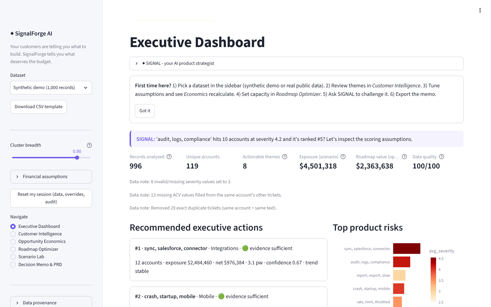
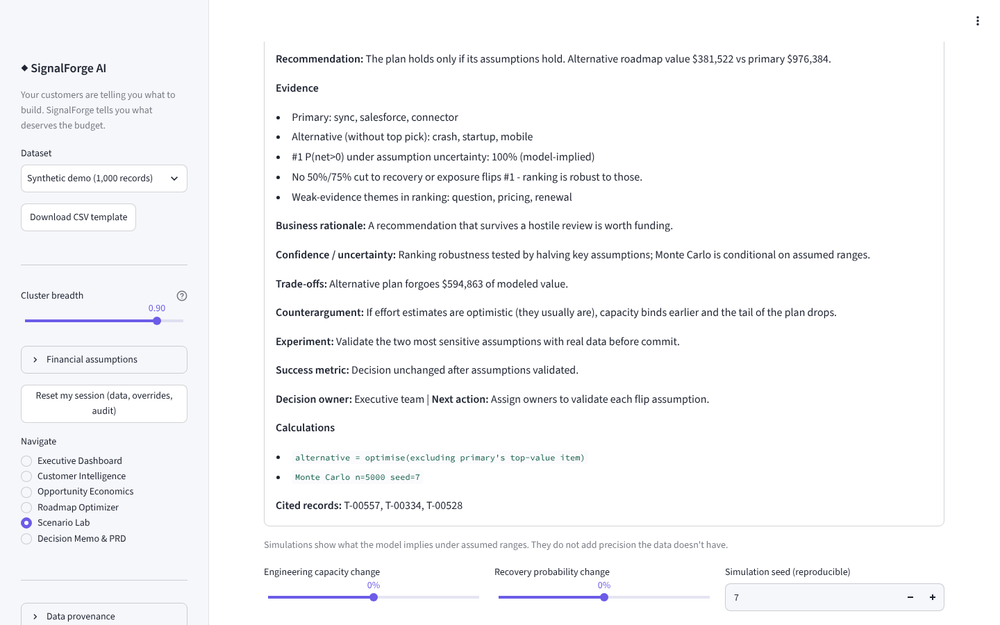

# SignalForge AI — Product Intelligence & Decision OS

> **Your customers are telling you what to build. SignalForge tells you what actually deserves the budget.**

SignalForge turns fragmented customer feedback into evidence-backed, financially-modeled, capacity-feasible product
decisions — and an AI strategist (**SIGNAL**) that argues with you about them using your actual numbers.

**Live demo:** _see "Deployment status" below_ · **CI:** GitHub Actions (`.github/workflows/ci.yml`)



## Customer problem → technical approach → AI → financial decision → product impact

| Step | What SignalForge does | Where |
|---|---|---|
| **Customer problem** | Product leaders drown in tickets, reviews and issues; roadmaps follow the loudest voice. | 6-page app |
| **Technical approach** | Schema detection & column mapping → validation, dedup, data-quality score → word+char TF-IDF → LSA → auto agglomerative / K-Means clustering | `datasets.py`, `ingestion.py`, `intelligence.py` |
| **AI intelligence** | Explainable themes (shared terms, representative + contradicting records), signal tags, volume-normalised trends, evidence sufficiency vs model confidence; SIGNAL copilot with 10-field grounded recommendations | `signals.py`, `pipeline.py`, `copilot.py` |
| **Financial decision** | Unique-account exposure (no double counting), ROI, payback, cost of delay, Monte Carlo, 7 prioritisation frameworks, weight sensitivity, **integer-programming roadmap** under capacity/budget/dependencies | `economics.py`, `prioritization.py`, `optimizer.py` |
| **Product impact** | Decision pack: memo, PRD, opportunity assessment, evidence appendix, roadmap, experiment plan, decision log (MD + DOCX) | `exports.py` |

Business outcomes of using SignalForge have **not** been measured; the experimentation plan defines how they would be.

## The six pages (+ SIGNAL on every page)
| Page | Highlights |
|---|---|
| Executive Dashboard | evidence-backed SIGNAL banner, KPIs with calculation tooltips, top actions, risks, emerging issues, data quality |
| Customer Intelligence | filters, theme explorer ("why grouped"), evidence & affected accounts, merge / split / reject / rename / undo, merge suggestions, duplicates |
| Opportunity Economics | fact/assumption/estimate/unknown separation, formulas, value vs investment, bear/base/bull, P10–P90 |
| Roadmap Optimizer | framework selector + custom weights + segment importance, framework comparison, sensitivity, capacity/budget/confidence/mandatory/dependencies, optimal vs greedy vs alternative plan, overrides, exports |
| Scenario Lab | capacity & recovery shocks, seeded Monte Carlo, tornado, decision threshold, uncertainty histogram |
| Decision Memo & PRD | seven generated documents (MD/DOCX), full decision pack, audit trail export |



## Data (real + clearly-labelled synthetic)
Synthetic SaaS demo (fictional, badged) · **F-Droid Google Play reviews** (real) · **Bitext customer-service intents**
(real/NLG, CDLA-Sharing-1.0) · **GitHub issues from any public repo** (live API) · your own CSV/JSON/JSONL/XLSX.
Third-party data is fetched at runtime and never committed. Full registry: [`docs/dataset-provenance.md`](docs/dataset-provenance.md).

## Measured results (2026-11-17, `python scripts/evaluate.py`)
| | Result |
|---|---|
| Synthetic templates (labelled) | ARI 0.999, NMI 0.992, purity 1.00 |
| Held-out paraphrases + typos (labelled) | ARI 0.302, purity 0.98, **false-split 0.80** (known lexical limitation) |
| Real F-Droid reviews (1,500) | 27 themes, largest 9.5%, silhouette 0.12, subsample stability ARI 0.13; previously 287 fragments |
| Latency | 976 records 0.54 s · 4,857 records 3.15 s (budgets 5 s / 30 s, set beforehand) |
| Tests | 108 unit/property/integration/security + 2 real-browser E2E journeys passing locally |

Details and caveats: [`docs/model-evaluation-report.md`](docs/model-evaluation-report.md) · [`docs/limitations.md`](docs/limitations.md).

## Run it
```bash
pip install -r requirements.txt
streamlit run app.py                       # http://localhost:8501
pip install -r requirements-dev.txt
pytest -q                                  # unit, property (Hypothesis), integration (AppTest), security
python -m playwright install chromium && pytest -m e2e tests/e2e   # real-browser journey, writes screenshots
python scripts/evaluate.py                 # clustering quality / stability / latency report
docker build -t signalforge . && docker run -p 8501:8501 signalforge
```
Optional: `ANTHROPIC_API_KEY` (server-side secret) lets SIGNAL narrate its grounded analysis with an LLM. Everything
works without it.

## Docs
Product: [vision](docs/product-vision.md) · [JTBD](docs/jobs-to-be-done.md) · [personas](docs/customer-personas.md) ·
[PRD](docs/PRD.md) · [roadmap & trade-offs](docs/roadmap-and-tradeoffs.md) · [30/60/90](docs/30-60-90-day-plan.md) ·
[experimentation plan](docs/experimentation-plan.md) · [demo walkthrough](docs/demo-walkthrough.md)
Technical: [architecture](docs/architecture.md) · [financial & prioritisation methodology](docs/financial-methodology.md) ·
[SIGNAL copilot](docs/signal-copilot.md) · [model evaluation](docs/model-evaluation-report.md) ·
[dataset provenance](docs/dataset-provenance.md) · [security & privacy](docs/security-threat-model.md) ·
[deployment](docs/deployment.md) · [limitations](docs/limitations.md)

## Deployment status
See [`BUILD_STATUS.md`](BUILD_STATUS.md) for what is verified, with evidence.

License: MIT (project code). Third-party datasets keep their own terms (see provenance registry).
