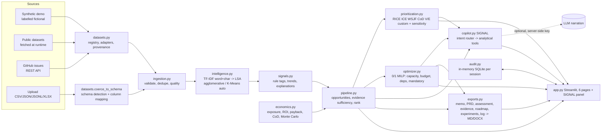

# Technical & data architecture

**Boundaries.** Every module under `src/signalforge` is UI-free and unit-tested; `app.py` only wires widgets to functions.
**State.** Per-visitor `st.session_state` holds an in-memory SQLite `AuditStore` (overrides + audit trail). Nothing is
written to disk or shared between sessions; `st.cache_data` caches only pure functions of public/synthetic inputs and
clustering results keyed by the input frame (no per-user state in caches). This is *not* durable multi-user storage:
the upgrade path is swapping `AuditStore` for PostgreSQL with tenant keys.
**Determinism.** LSA uses `random_state=0`, K-Means `random_state=0`, Monte Carlo seeds are user-visible.
**Model choice.** `sentence-transformers` remains an optional backend (`prefer_transformer=True`); it is not the default
because model download + torch exceed the free hosting memory budget and could not be verified offline. See
`docs/model-evaluation-report.md` for the measured cost of that decision (paraphrase recall).

## Data model (per record)
`ticket_id, account_id, customer_segment, annual_contract_value, product_area, feedback_text, severity, frequency,
created_at, status, estimated_engineering_effort` (+ optional `source`, `ground_truth_issue`). Public adapters fill
`annual_contract_value` and `estimated_engineering_effort` with **missing**, never zero.
