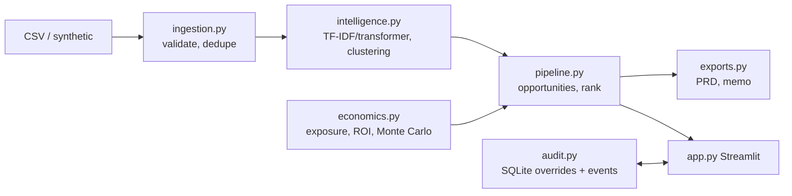

# Architecture

Domain logic is UI-free and unit-tested. SQLite for local MVP; PostgreSQL is the upgrade path (swap `AuditStore`). Embeddings: TF-IDF by default (deterministic, offline); `sentence-transformers` is used when requested and available. Deviation from the original spec: flat module layout (one file per service) instead of nested packages, since each service is small.
